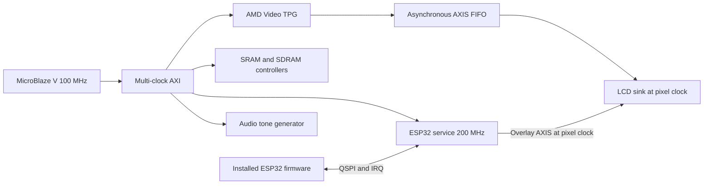

# GameBub Vivado and Vitis developer guide

Build a Rev4 GameBub system from independent Vivado IP and program it with bare-metal MicroBlaze V applications. These guides target Vivado/Vitis 2025.2, board-file 2.0 and the [reference IP inventory](amd-ip.md). Board-file version is not the PCB revision. GameBub custom IP is not supported or certified by AMD.

## Start here

1. [Create the Vivado project](getting-started.md).
2. [Connect clocks and resets](clocks-resets.md).
3. [Create a Vitis workspace and build separate applications](vitis-workflow.md).
4. Read [memory ownership and caches](memory-cache.md) before using SRAM or SDRAM.
5. Use the [troubleshooting guide](troubleshooting.md) when validation, software discovery or physical output differs from expectations.

| Interface | Guide | Software |
| --- | --- | --- |
| ESP32 QSPI, IRQ gate, buttons and overlay | [ESP32](ips/esp32/README.md) | GBEsp32 |
| 512 KiB SRAM | [SRAM](ips/sram/README.md) | GBSram controls and ordinary memory access |
| 32 MiB SDR SDRAM | [SDRAM](ips/sdram/README.md) | GBSdram controls and ordinary memory access |
| RGB LCD and AXI video streams | [LCD](ips/lcd/README.md) | AMD XV_tpg and ESP32 overlay APIs; no LCD register bank |
| DAC tone generator | [Audio](ips/audio/README.md) | GBAudio |
| Vibration, processor, interrupt controller and infrastructure | [AMD IP integration](amd-ip.md) | Existing AMD drivers where applicable |

The [software repository](../../fpga/sw_repo/README.md) contains drivers and examples. The [reproducible reference](../../fpga/vivado/gamebub_ipi_demo/README.md) preserves the user's revised block diagram. Read [validation status](validation.md) before interpreting a successful build as hardware qualification. The [implementation plan](../../fpga/board_files/IP_DOCUMENTATION_DRIVER_PLAN.md) remains the longer-term checklist.

Markdown is the canonical documentation. Generated HTML/API pages are outputs, not separately maintained sources. All commands that create projects/workspaces require a new output directory; do not overwrite a project you are editing.
